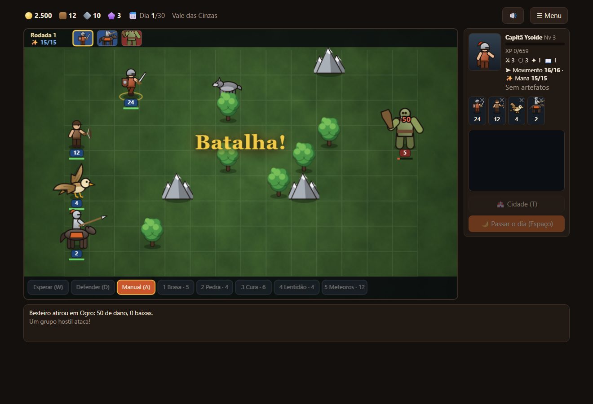
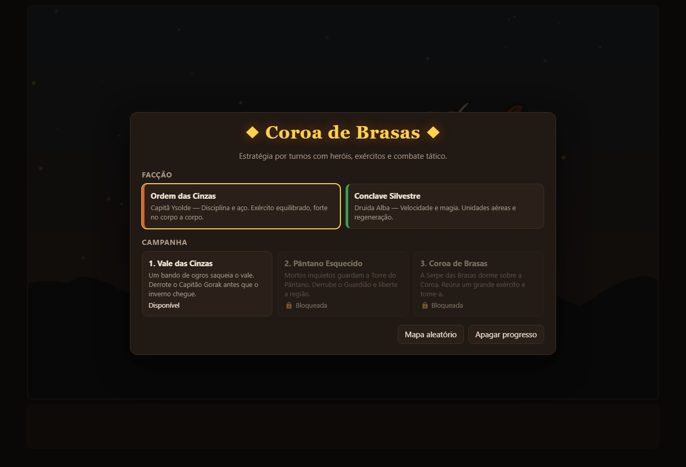
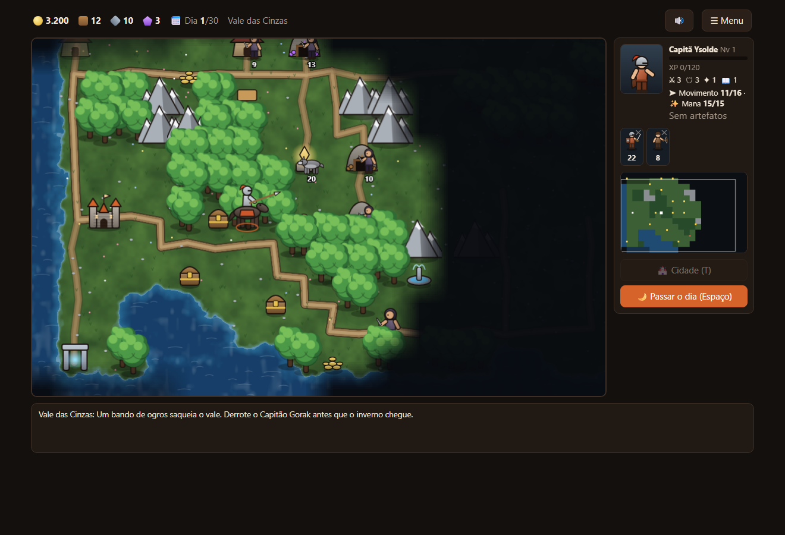
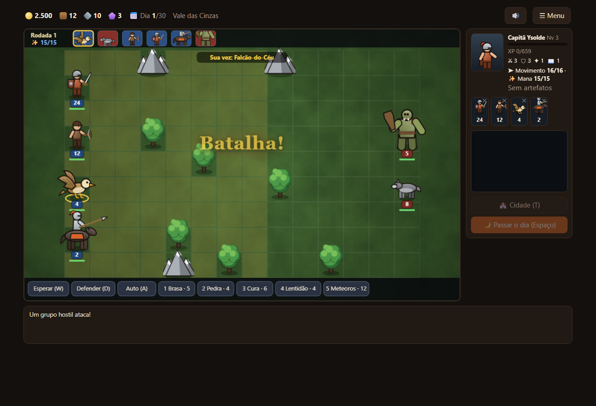
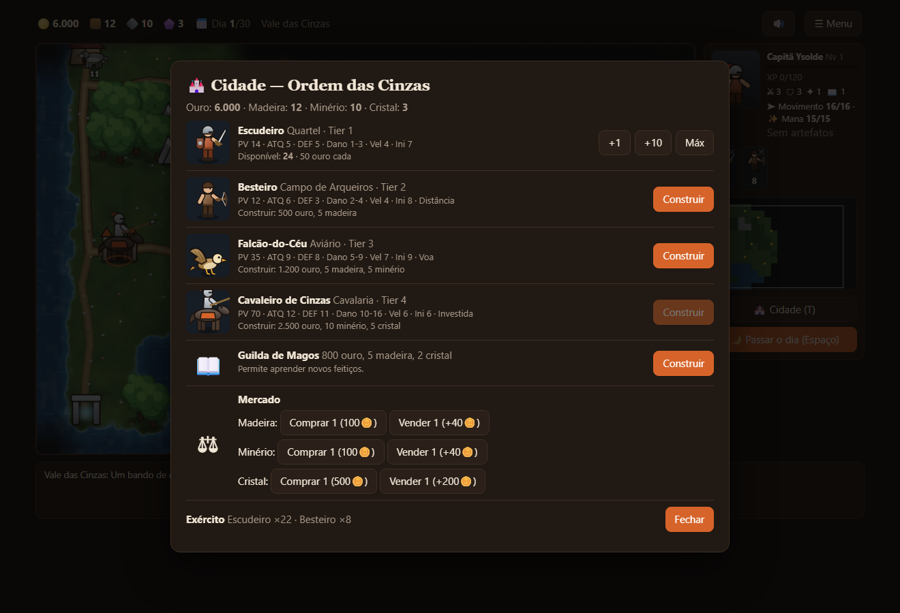
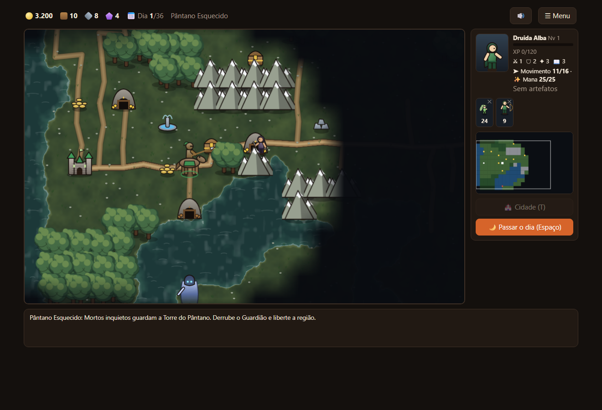
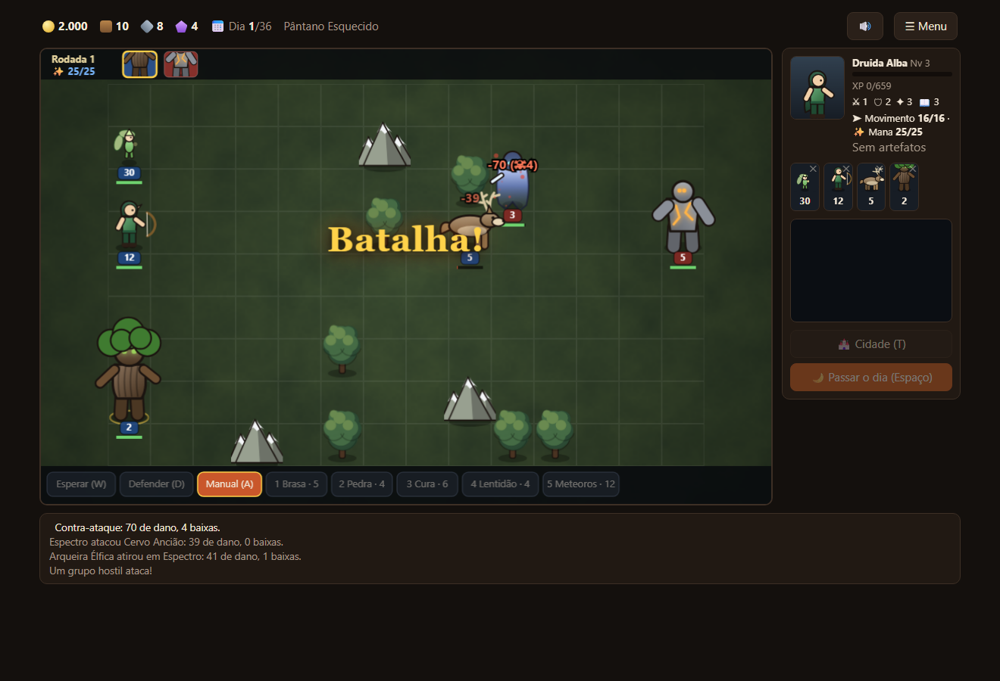
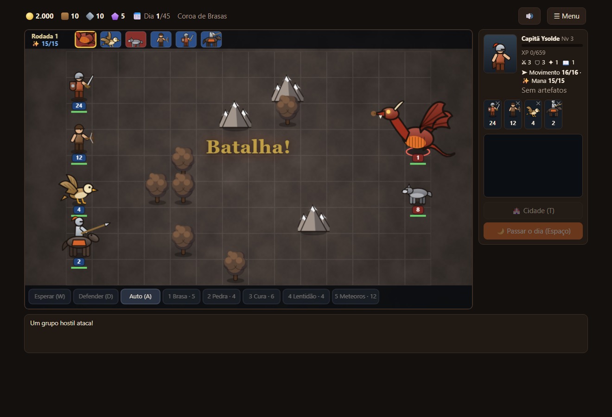
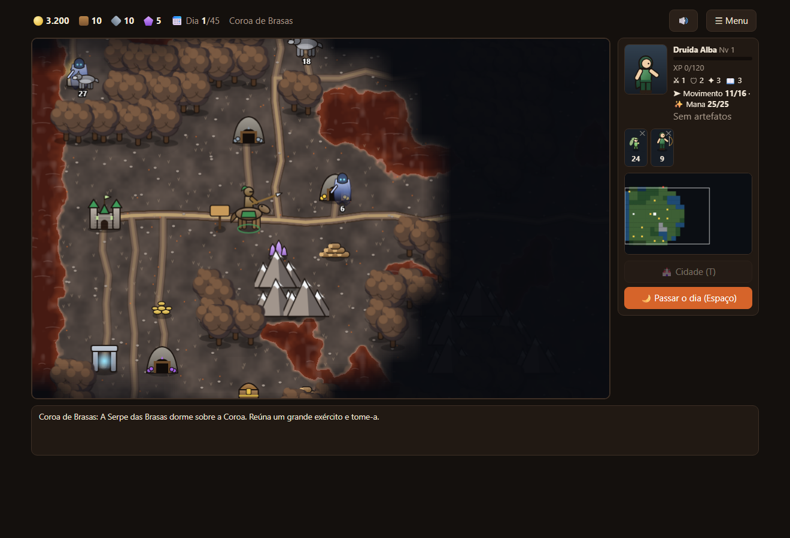

# Coroa de Brasas

**Estratégia por turnos com heróis, exércitos e combate tático.** Explore o mapa, conquiste minas, recrute tropas, suba de nível e derrote o chefe de cada missão.
Jogue no navegador (funciona offline) ou no Windows. Arte, código, nomes e dados são originais.

[**▶ Jogar agora**](https://coroa-de-brasas-demo.vercel.app) · [**⬇ Baixar para Windows**](https://coroa-de-brasas-demo.vercel.app/baixar) · [Novidades](CHANGELOG.md)

## Como é

| | |
|---|---|
| 🗺 **Mapa de aventura** | Neblina de guerra, minimapa, estradas, minas de ouro, madeira, minério e cristal, acampamentos de recrutamento, baús, artefatos, santuários e monstros guardando tesouros — cada grupo mostra se é *trivial*, *fácil*, *equilibrado*, *difícil* ou *mortal* para o seu exército. |
| ⚔ **Combate tático** | Grade 14×9 com ordem de iniciativa, contra-ataque, unidades voadoras, atiradores, investida de cavalaria e regeneração. O jogo prevê o dano do seu golpe antes de você clicar. |
| ✨ **Magia** | Raio de Brasa, Pele de Pedra, Cura, Lentidão e Chuva de Meteoros, com efeitos, status e mana. |
| 🏰 **Cidade e herói** | Construa moradias por tier, aprenda feitiços na Guilda de Magos, negocie no mercado. O herói ganha níveis e artefatos e segue com seu exército para a próxima missão. |
| 🎲 **Rejogável** | Campanha de 3 missões e **mapas aleatórios** gerados por semente, sempre conectados e com tesouros e perigos proporcionais à distância. |
| 🧠 **IA** | Os inimigos avaliam valor de alvo e risco de contra-ataque. Prefere resolver rápido? Use o botão **Auto** no combate. |

## Telas

| Menu | Mapa — Vale das Cinzas | Combate |
|---|---|---|
|  |  |  |

| Cidade | Mapa — Pântano Esquecido | Combate contra o Golem |
|---|---|---|
|  |  |  |

| A Serpe das Brasas | Terras Cinzentas |
|---|---|
|  |  |

## Facções

**Ordem das Cinzas** — disciplina e aço. Escudeiro, Besteiro, Falcão-do-Céu e Cavaleiro de Cinzas (investida). Herói: Capitã Ysolde.
**Conclave Silvestre** — velocidade e magia. Duende voador, Arqueira Élfica, Cervo Ancião e o gigante Ent (regenera). Herói: Druida Alba.

## Missões

1. **Vale das Cinzas** — um bando de ogros saqueia o vale. Derrote o Capitão Gorak.
2. **Pântano Esquecido** — mortos inquietos guardam a Torre do Pântano.
3. **Coroa de Brasas** — a Serpe das Brasas dorme sobre a Coroa.

## Controles

**Mapa:** clique para andar · `Espaço` passa o dia · `T` cidade · setas/WASD movem a câmera · clique no minimapa.
**Combate:** clique numa célula laranja para mover e num inimigo para atacar · `W` esperar · `D` defender · `1`–`5` magias · `A` auto · `Esc` cancela.

## Dicas

- Passe o mouse sobre um monstro no mapa para ver a dificuldade antes de lutar.
- Conquiste as minas cedo: a renda diária decide a campanha.
- As tropas crescem toda semana (a cada 7 dias) — espere o reabastecimento antes de enfrentar o chefe.
- Falcões e duendes voam: ótimos para alcançar atiradores atrás de obstáculos.

## Baixar

| Arquivo | Para quê |
|---|---|
| [`CoroaDeBrasas-Setup-2.0.0.exe`](https://github.com/srlorenzos/coroa-de-brasas/releases/download/v2.0.0/CoroaDeBrasas-Setup-2.0.0.exe) | Instalador |
| [`CoroaDeBrasas-Portable-2.0.0.exe`](https://github.com/srlorenzos/coroa-de-brasas/releases/download/v2.0.0/CoroaDeBrasas-Portable-2.0.0.exe) | Versão portátil |

Hashes SHA-256 em [`SHA256SUMS.txt`](https://github.com/srlorenzos/coroa-de-brasas/releases/download/v2.0.0/SHA256SUMS.txt). O jogo ainda **não é assinado digitalmente**: o Windows SmartScreen pode avisar na primeira execução (*Mais informações* → *Executar assim mesmo*).

## Roadmap

- Mais facções (mortos-vivos, demônios) e tiers 5 a 7
- Mais habilidades de herói e artefatos
- Heróis rivais no mapa e cercos de cidade
- Editor de mapas e partidas multijogador local

---

Feito por [Eduardo Lorenzo](https://github.com/srlorenzos). O código-fonte é privado; esta página é a vitrine pública do jogo.
